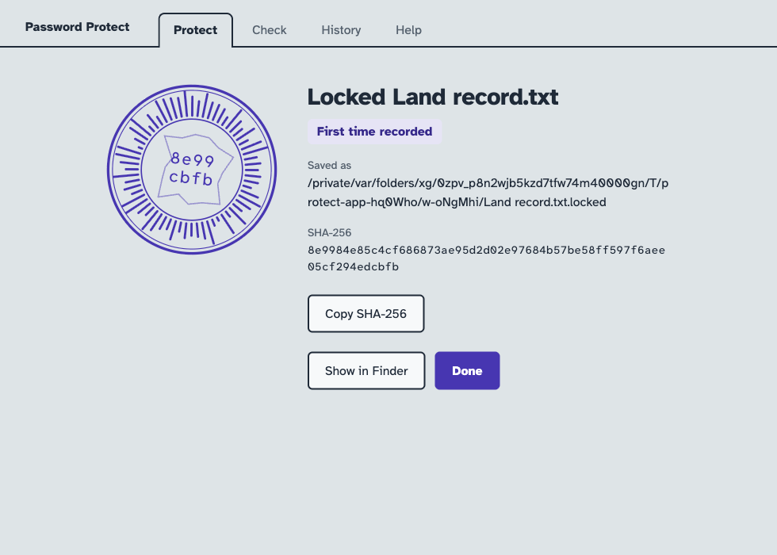

# Password Protect

Lock any file or folder behind a password on Windows or macOS, and prove later
that its contents did not change.

- **Locking** turns a file or folder into one encrypted `.locked` file.
- **Unlocking** restores the original, including its folders and modified times.
- **Every lock and unlock is recorded** with who did it, when, and a SHA-256
  fingerprint of the contents.
- **Works across machines.** A file locked on Windows unlocks on macOS, and the
  reverse.

> **A forgotten password cannot be recovered.** There is no reset and no back
> door. Keep it in a password manager.



## Download

Get the latest version from the [Releases page](../../releases/latest).

| Your computer | Download |
| --- | --- |
| Windows 10 or 11 (64-bit) | `PasswordProtect-<version>-win-x64.exe` |
| Mac with Apple silicon (M1 or later) | `PasswordProtect-<version>-mac-arm64.dmg` |

**The [user manual](docs/MANUAL.md) explains everything step by step,** including
how to encrypt and decrypt a file, and how to prove that one did not change. The
same instructions are on the **Help** tab in the app.

## Quick start

1. Install the app and open it.
2. **To encrypt:** drag a file or folder into the window, enter a password and
   choose **Lock**. You get a `.locked` file.
3. **To decrypt:** double-click the `.locked` file, enter the password and choose
   **Unlock**.

Only the `.locked` file is protected. If you keep the original, that copy can still
be opened by anyone with access to it.

## Command line

Scripts can use the `command-line-only` download from the Releases page.

```sh
protect lock Reports                     # creates Reports.locked
protect lock Reports --remove            # also deletes the verified original
protect unlock Reports.locked -o Restored
protect verify Reports.locked --against <sha256>
protect hash Reports                     # needs no password
protect history Reports --limit 10
protect unzip Reports.zip
```

`verify` exits with status 1 if the comparison fails. `--password-stdin` supplies a
password to scripts. It is never accepted as an argument, because arguments are
visible to other programs.

For a single file, the SHA-256 is its ordinary SHA-256, so `shasum -a 256` on a Mac
and `certutil -hashfile <file> SHA256` on Windows give the same answer. A folder's
SHA-256 covers each item's relative path and contents, so use `protect hash`.

## How it protects your files

- **Encryption:** AES-256-GCM. The key comes from your password through scrypt
  (N=2^17, r=8, p=1), so each guess costs 128 MiB of memory.
- **Hidden:** contents, names of everything inside a locked folder, and who
  locked it.
- **Tamper-evident:** any edit, reordering or truncation is detected, and nothing
  is restored from a damaged file.

## Limits

- The name and size of the `.locked` file are visible. `Tax Docs` becomes
  `Tax Docs.locked`; use `-o` to give it a neutral name.
- Deleting an original is an ordinary delete, and traces can remain on an SSD.
  FileVault or BitLocker covers that.
- Finder tags, other extended attributes and ACLs are not restored. Windows has
  no permission bits, so only its read-only flag carries across.
- On Windows, names it cannot store (such as `what?.txt`) are renamed on restore,
  and symlinks are skipped unless Developer Mode is on. The app reports both.
- Zips with their own password cannot be extracted.
- Sockets, pipes and devices cannot be locked.
- History is kept per computer, records the logged-in account rather than a proven
  person, and is an ordinary editable file. It also contains file names. See the
  [manual](docs/MANUAL.md#6-see-who-locked-or-unlocked-what).

## Development

```sh
npm install
npm start                        # run the app
npm test                         # engine tests
npm run test:app                 # drive the real app
npm run build:mac                # or build:win, writes to release/
```

Pushing to `main` runs the tests on Windows and macOS. Pushing a tag such as
`v1.2.0` also tests the built apps, checks that each OS opens what the other
locked, and publishes a GitHub release.

## License

[MIT](LICENSE)
