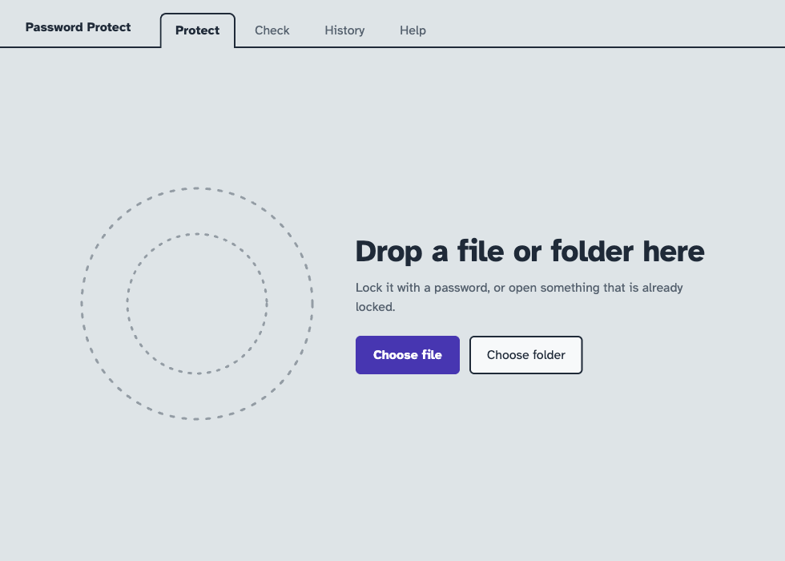
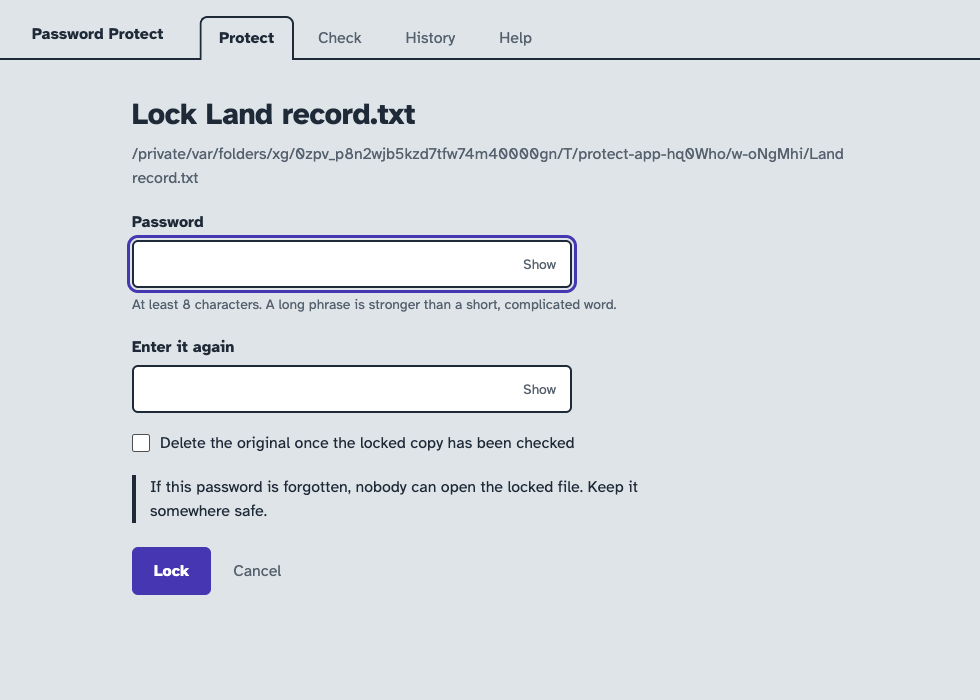
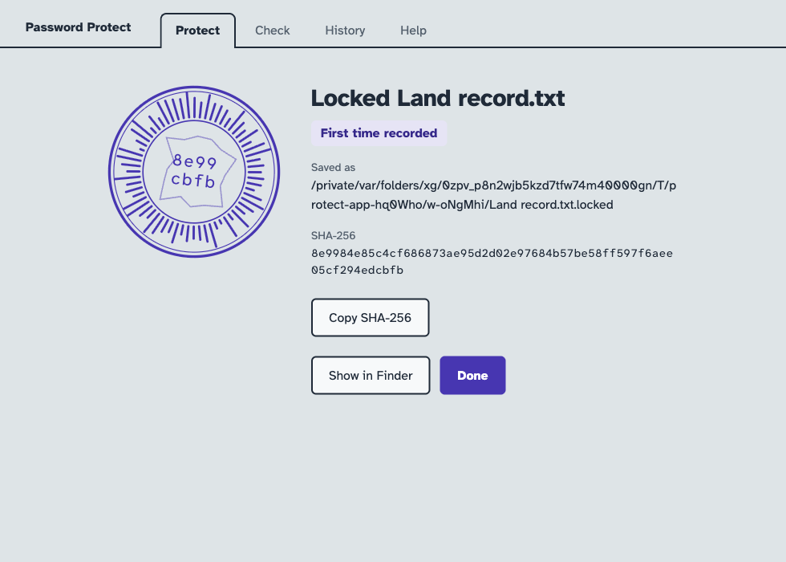
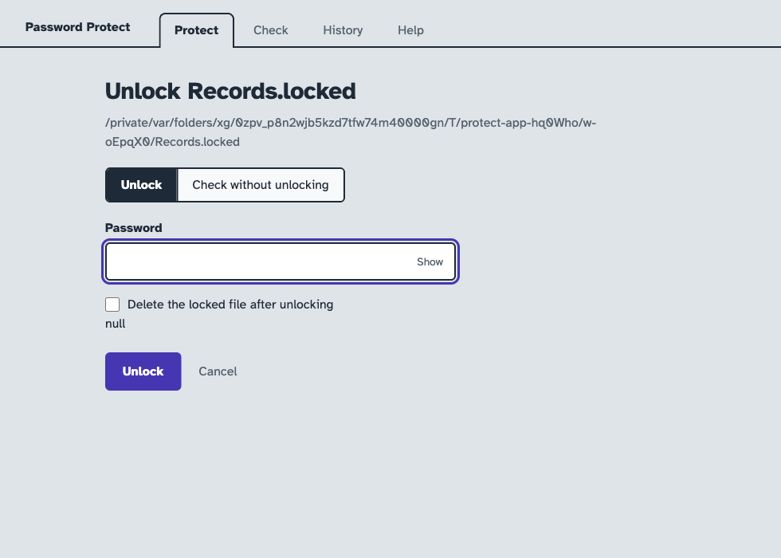

# Password Protect user manual

This manual shows how to encrypt and decrypt files on Windows and macOS. No
technical knowledge is needed. In the app, encrypting is called **locking** and
decrypting is called **unlocking**.

> **A forgotten password cannot be recovered.** Nobody can open a locked file
> without its password, including the makers of this app. Keep the password
> somewhere safe.

The same instructions are in the app, on the **Help** tab.

## Contents

1. [Install the app](#1-install-the-app)
2. [Encrypt a file or folder](#2-encrypt-a-file-or-folder)
3. [Decrypt a file or folder](#3-decrypt-a-file-or-folder)
4. [Send a locked file to someone](#4-send-a-locked-file-to-someone)
5. [Prove that a file did not change](#5-prove-that-a-file-did-not-change)
6. [See who locked or unlocked what](#6-see-who-locked-or-unlocked-what)
7. [Extract a zip file](#7-extract-a-zip-file)
8. [Solve problems](#8-solve-problems)

## 1. Install the app

Download the app from the
[Releases page](https://github.com/bhskr44/password-protect/releases/latest).

### On Windows 10 or 11 (64-bit)

Windows 7, Windows 8 and 32-bit Windows are not supported.

1. Download `PasswordProtect-<version>-win-x64.exe`.
2. Double-click the download.
3. If Windows shows **Windows protected your PC**, choose **More info**, then
   **Run anyway**.
4. A small progress bar appears for a few seconds. The app then installs and
   opens by itself. Find it later in the Start menu as **Password Protect**.

Files named `command-line-only` open no window. They are only for scripts, so do
not download them.

### On a Mac with Apple silicon (M1 or later)

1. Download `PasswordProtect-<version>-mac-arm64.dmg`.
2. Double-click the download.
3. Drag **Password Protect** onto the **Applications** folder.
4. Open **Password Protect** from Applications.
5. If macOS says it cannot be opened, go to **System Settings > Privacy &
   Security**, scroll down and choose **Open Anyway**.

These warnings appear because the app is not signed with a paid developer
certificate. You only see them the first time.

## 2. Encrypt a file or folder

1. Open Password Protect.

   

2. Drag the file or folder into the window. Or choose **Choose file** or
   **Choose folder** and select it. You can select several at once.
3. Type a password in **Password**, then type it again in **Enter it again**.
   Use at least 8 characters. A long phrase is stronger than a short word.

   

4. To remove the unprotected copy, tick **Delete the original once the locked
   copy has been checked**. Leave it unticked to keep the original.
5. Choose **Lock**.

   

A new file ending in `.locked` appears next to the original. For example,
`Report.pdf` gives `Report.pdf.locked`, and a folder called `Tax Docs` gives
`Tax Docs.locked`.

**Only the `.locked` file is protected.** If you kept the original, that copy can
still be opened by anyone who has access to it.

## 3. Decrypt a file or folder

1. Double-click the `.locked` file. Or open Password Protect and drag the file
   into the window.
2. Type the password.

   

3. Choose **Unlock**.

The original appears next to the locked file, with its original name. A locked
folder comes back as a folder, with everything inside it. A locked zip is
extracted as well.

To remove the locked file afterwards, tick **Delete the locked file after
unlocking** first.

Lock the item again when you finish. Once unlocked, it is an ordinary file that
anyone with access can open.

## 4. Send a locked file to someone

1. Send the `.locked` file by any route, such as email or a USB drive.
2. Tell them the password **a different way**, such as a phone call. Never put
   the password in the same message as the file.
3. They install Password Protect and unlock the file.

Files move freely between Windows and Mac. A file locked on one opens on the
other with the same password.

## 5. Prove that a file did not change

Every item has a **seal** and a **SHA-256**, a 64-character code. The same
contents always give the same seal and SHA-256. If even one letter changes, both
change completely. Unlocking checks this automatically.

### Compare two computers

1. On the first computer, lock the item. Choose **Copy SHA-256** and keep the
   code.
2. Send the `.locked` file to the second computer.
3. On the second computer, open the `.locked` file and choose **Check without
   unlocking**.
4. Type the password and paste the SHA-256 into **SHA-256 from the other
   computer**.
5. Choose **Check**.

You see **Match: identical content** in green, or **Does not match** in red.
Checking needs the password, and nothing is unlocked or written to disk.

Send the SHA-256 by a different route from the file. Someone who could alter the
file on its way could otherwise alter the code too.

### Check a file that is not locked

1. Open the **Check** tab.
2. Choose **Choose file** or **Choose folder**, or drag the item in.
3. Paste a SHA-256 into **Compare with a SHA-256**.

This also shows whether the same contents appear in the history.

## 6. See who locked or unlocked what

Open the **History** tab. Each entry shows the action, time, item, the person
logged in, the computer, the seal and the result. Search by name, person or
SHA-256.

| Result | Meaning |
| --- | --- |
| First time recorded | This computer has not seen this content before |
| Same content as the last record | Nothing changed since last time |
| Changed since the last record | The content is different from last time |
| Identical to what was locked | The unlocked item matches what was locked |
| Match | The content matches the SHA-256 you compared |
| Does not match | The content differs from the SHA-256 you compared |

What the history can and cannot show:

- **Each computer keeps its own history.** Nothing is sent anywhere, so to see
  both sides, look at both computers.
- **A locked file carries who locked it and when.** That travels with the file
  and appears when it is unlocked or checked. Unlocks on another computer are
  only in that computer's history.
- **"Who" means the account logged in to the computer.** It is not proof of who
  was sitting there.
- **History is an ordinary file on the computer.** Someone with access could
  edit it, so copy it elsewhere if it needs to serve as evidence.
- **History contains file names and locations.** It never contains passwords.

## 7. Extract a zip file

1. Drag the `.zip` into the window.
2. Choose **Extract**, then **Extract** again. This does not need a password.

The contents appear in a new folder next to the zip. Zips that have their own
password cannot be extracted.

## 8. Solve problems

| Message | What to do |
| --- | --- |
| Wrong password, or the file is corrupted | Check the password, including capital letters. If it still fails, the file may be damaged, so ask for a fresh copy. |
| Already exists | Something with that name is already in the folder, and it is never overwritten. Move or rename it, then try again. |
| The two passwords do not match | Type both again. Choose **Show** to see what you typed. |
| Access was denied | Close any program using the item, then try again. |
| The disk is full | Free some space. Locking needs room for a full copy. |
| Renamed for Windows | The Mac name used characters Windows cannot store, such as `?`. The contents are unchanged. |
| Skipped symlink | Windows needs Developer Mode to restore shortcuts of this type. |

**No window appears on Windows:**

1. Make sure you downloaded `PasswordProtect-<version>-win-x64.exe` from the
   latest release, not an older `.exe` or a `command-line-only` file. A black text
   window means you have one of those.
2. Run that download once to install it. Then open **Password Protect** from the
   Start menu, not the download.
3. Check for it behind other windows, or on the taskbar.
4. Check your version of Windows: press the Windows key, type `winver` and press
   Enter. You need Windows 10 or 11. Choose **Settings > System > About** and
   check that **System type** says 64-bit.

**Forgotten password:** the locked file cannot be opened by anyone. Use another
copy of the original if you have one.

**Double-clicking a `.locked` file does nothing:** open Password Protect and drag
the file into the window.
